# Complaint lakehouse with BigQuery SQL

A build-along project that captures public Traffy Fondue complaint observations into Cloud
Storage, processes them with BigQuery SQL, and publishes BigQuery-managed Apache Iceberg
Silver and Gold tables. Cloud Composer orchestrates the batch after the manual steps work.

Start with **[the build-along tutorial](docs/build-along.md)**. It walks through creating your
resources, extracting the API, loading raw pages, writing SQL transformations, creating Iceberg
tables, validating results, and deploying Composer. All examples use `project_name` placeholders.
You create and manage your GCP resources yourself.

```mermaid
flowchart LR
    subgraph Composer["Cloud Composer · Orchestrates the entire pipeline"]
        direction LR
        subgraph SourceZone["DATA SOURCE"]
            Source["Python collects complaints<br/>from the public API"]
        end
        subgraph BronzeZone["Bronze (Original data)"]
            Bronze["Keep original responses in Cloud Storage<br/>check files before loading"]
        end
        subgraph ProcessingZone["CLEAN AND CHECK · BIGQUERY SQL"]
            Processing["Load responses into BigQuery<br/>clean values and check for problems"]
        end
        subgraph Transaction["Save results together · all succeed or none are saved"]
            direction LR
            Gates["Check data quality and Deduplicate<br/>(keep one record per complaint)"]
            subgraph SilverZone["Silver (Clean data) · Iceberg"]
                Silver["Latest known complaint details<br/>and a history of what we collected"]
            end
            subgraph GoldZone["Gold (Summaries) · Iceberg"]
                Gold["Summarize the sample<br/>and show changes we observed"]
            end
            Receipt["Record the completed run<br/>to avoid saving it twice"]
            Gates --> SilverZone --> GoldZone --> Receipt
        end
        SourceZone --> BronzeZone --> ProcessingZone --> Transaction
    end
    style Composer fill:#eff6ff,stroke:#3b82f6,stroke-width:2px,stroke-dasharray:6 4,color:#1e3a8a
    style SourceZone fill:#f8fafc,stroke:#94a3b8,color:#334155
    style BronzeZone fill:#fff7ed,stroke:#c28748,color:#7c451b
    style ProcessingZone fill:#eef2ff,stroke:#818cf8,color:#3730a3
    style Transaction fill:#ffffff,stroke:#64748b,stroke-dasharray:4 4,color:#334155
    style SilverZone fill:#f1f5f9,stroke:#94a3b8,color:#334155
    style GoldZone fill:#fffbeb,stroke:#d4a72c,color:#854d0e
```



Read left to right: collect data, keep the originals, clean and check, then save clean data
and summaries. Bronze means original data, Silver means clean data, and Gold means summaries.
Cloud Composer runs the steps in order. Inside the dashed box, result updates succeed together
or none are saved.

Python handles API calls, file integrity and job submission. SQL handles record parsing,
validation, status classification, deduplication, merges and aggregations. No Dataflow worker,
Beam dependency, Flex Template or container build is required.

## Repository structure

| Path | Purpose |
| --- | --- |
| `docs/build-along.md` | Step-by-step manual tutorial and full pipeline diagram |
| `docs/sql/01_tables.sql` | Readable staging, ops and Iceberg DDL |
| `docs/sql/02_normalize.sql` | Readable JSON parsing and validation SQL |
| `docs/sql/03_publish.sql` | Readable transactional Silver/Gold publication SQL |
| `tutorials/` | Visible extraction, load-file preparation and query-submission examples |
| `src/complaint_pipeline/sql/` | Executable SQL templates; source of the teaching SQL copies |
| `src/complaint_pipeline/ingest.py` | Verify page bytes, prepare NDJSON and load raw pages |
| `src/complaint_pipeline/warehouse.py` | Bind query parameters and wait for SQL jobs |
| `dags/complaint_medallion.py` | `extract → load_raw → normalize_sql → publish_sql` |
| `config/example.json` | Placeholder configuration; keep real settings in ignored `config/local.json` |
| `tests/` | Local extraction/load tests and opt-in BigQuery SQL integration test |

## Local checks

```sh
python3.11 -m venv .venv
source .venv/bin/activate
pip install -e '.[gcp,dev]'
python -m unittest discover -s tests -v
ruff check .
```

These checks do not create cloud resources. The live SQL test is opt-in; see
[the test guide](docs/tutorial.md). To inspect raw transport entirely offline:

```sh
complaint-pipeline capture-fixture --input examples/complaints.json
complaint-pipeline prepare-load --manifest work/bronze/run_id=demo/manifest.json \
  --processing-id offline-1 --output work/raw-pages-offline-1.jsonl
```

The output contains raw pages, not normalized records. BigQuery executes normalization.
The synthetic fixture has four complaints: the SQL test expects three accepted and one
rejected. At the default 5% rejection threshold that sample must fail publication.

## Guides and limits

- [Build along](docs/build-along.md): individual resource and processing steps.
- [GCP setup reference](docs/gcp-setup.md): resources, IAM and application commands.
- [Migration from Dataflow](docs/migration-to-bigquery-sql.md): reuse existing resources and captures.
- [Data contract](docs/data-contract.md): sample coverage, retention, quality and replay semantics.
- [Troubleshooting](docs/troubleshooting.md): BigQuery loading, SQL and Composer failures.

This pipeline captures bounded samples using `limit` and `offset`. It does not implement CDC,
source snapshots, deletions or a complete citywide backlog. Gold metrics describe individual
samples. Publishers must be serialized. Managed Iceberg storage files are changed only by
BigQuery through its Cloud resource connection.
