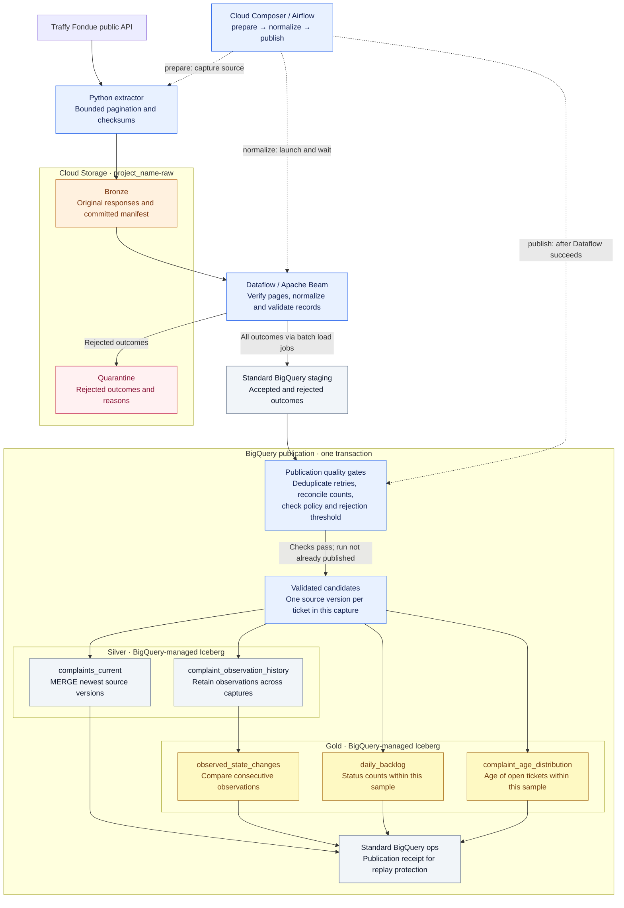

# Build Traffy Lakehouse, one component at a time

This is the authoring path for your own tutorial. Readers build and inspect each component
before combining them. The finished application's `complaint-pipeline` CLI is optional
convenience tooling after the lessons, not a prerequisite or a substitute for the code.

All GCP project identifiers below are `project_name` placeholders. You run provisioning and
deployment commands yourself. The guide does not assume the resources already exist.

For each chapter, explain the problem, write or inspect the relevant code, execute that step,
and show evidence of its output. Screenshots of actual results belong after execution; the
checkpoints below describe what to capture for your article or video.

| Chapter | What the reader builds | Evidence to show |
| --- | --- | --- |
| 1 | GCP project access, buckets, datasets, and identities | Resources in the chosen region |
| 2 | A direct Python API request | Response structure and a few non-identifying fields |
| 3 | Bounded extraction and Bronze upload | Saved responses, hashes, and committed manifest |
| 4 | BigQuery connection and explicit table DDL | Staging and managed Iceberg tables |
| 5 | Beam transformations and a Dataflow job | Graph, rejected rows, and staging count |
| 6 | Quality gates, Silver MERGE, history, and Gold SQL | Publication receipt and sample reports |
| 7 | Flex Template packaging | Container image and template specification |
| 8 | Composer environment and DAG deployment | Three tasks completing in order |
| 9 | Retry and failure demonstrations | Repeatable results and failed quality gates |

## Pipeline diagram

The diagram shows the complete workflow after Composer is added. Earlier chapters run the
same stages manually. Solid arrows show processing and data dependencies; dotted arrows show
orchestration.



Silver and Gold table files live in `gs://project_name-warehouse/` and are managed by BigQuery
through the Cloud resource connection. Dataflow writes to standard staging, not directly to
those Iceberg files. The separate `project_name-pipeline-temp` bucket holds job artifacts such
as `pipeline.pb` and intermediate BigQuery load files; it is omitted from the main data flow.

Gold sample counts come from this capture's validated candidates. Observation history supplies
the change comparisons. The publication receipt commits with Silver and Gold; a failed
transaction leaves all of those published outputs unchanged. Bronze, staging, and quarantine
remain available for diagnosis and replay.

## Chapter 1 — Create the GCP foundation

### Set up your working environment

You need a billing-enabled GCP project, permission to create its resources, the Google Cloud
CLI, Python 3.11, and Docker for the later template chapter. Work from this repository's root.
Use a supported single region for the resources; examples use `asia-southeast1`.

Create the Python environment once, or activate your existing one:

```sh
python3.11 -m venv .venv
source .venv/bin/activate
python -m pip install -e '.[gcp,beam,dev]'

gcloud auth login
gcloud auth application-default login

export TUTORIAL_PROJECT="project_name"
export TUTORIAL_REGION="asia-southeast1"
export TUTORIAL_RAW_BUCKET="${TUTORIAL_PROJECT}-raw"
export TUTORIAL_WAREHOUSE_BUCKET="${TUTORIAL_PROJECT}-warehouse"
export TUTORIAL_TEMP_BUCKET="${TUTORIAL_PROJECT}-pipeline-temp"
export TUTORIAL_WORKER="dataflow-worker@${TUTORIAL_PROJECT}.iam.gserviceaccount.com"
export TUTORIAL_COMPOSER_SA="composer-worker@${TUTORIAL_PROJECT}.iam.gserviceaccount.com"
export TUTORIAL_RUN_ID="lesson-001"

gcloud config set project "$TUTORIAL_PROJECT"
gcloud auth application-default set-quota-project "$TUTORIAL_PROJECT"
```

Replace `project_name` before running cloud commands. The bucket names must also be globally
available. The first login is for `gcloud`; application default credentials are for Python
clients. Later, Dataflow and Composer use attached service accounts.

### Enable the APIs

```sh
gcloud services enable \
  storage.googleapis.com \
  bigquery.googleapis.com \
  bigqueryconnection.googleapis.com \
  bigquerystorage.googleapis.com \
  dataflow.googleapis.com \
  compute.googleapis.com \
  artifactregistry.googleapis.com \
  composer.googleapis.com \
  iam.googleapis.com
```

Enable any additional environment dependencies requested by the Composer creation workflow
in chapter 8. Cloud Build is unnecessary for the local Docker build shown later.

### Create three buckets

```sh
gcloud storage buckets create "gs://${TUTORIAL_RAW_BUCKET}" \
  --location="$TUTORIAL_REGION" --uniform-bucket-level-access --public-access-prevention
gcloud storage buckets create "gs://${TUTORIAL_WAREHOUSE_BUCKET}" \
  --location="$TUTORIAL_REGION" --uniform-bucket-level-access --public-access-prevention
gcloud storage buckets create "gs://${TUTORIAL_TEMP_BUCKET}" \
  --location="$TUTORIAL_REGION" --uniform-bucket-level-access --public-access-prevention
```

The raw bucket holds Bronze and quarantine. The temporary bucket holds Dataflow staging,
BigQuery load files, and template metadata. The warehouse bucket is reserved for files managed
by BigQuery's Iceberg tables. Keep their purposes separate so temporary-file cleanup does not
delete warehouse data.

### Create datasets and service accounts

```sh
for dataset in staging silver gold ops; do
  bq --location="$TUTORIAL_REGION" mk --dataset "${TUTORIAL_PROJECT}:${dataset}"
done

gcloud iam service-accounts create dataflow-worker --display-name="Dataflow tutorial worker"
gcloud iam service-accounts create composer-worker --display-name="Composer tutorial worker"
```

Use **IAM & Admin → IAM → Grant access** for project-level roles. Use each bucket's
**Permissions** tab for bucket access. Use **BigQuery → dataset → Sharing / Permissions**
for dataset-scoped access. Console labels may vary; the important distinction is the scope.

| Identity | Project roles | Dataset/bucket access |
| --- | --- | --- |
| Dataflow worker | Dataflow Worker, BigQuery Job User | BigQuery Data Editor on `staging`; Storage Object Viewer on raw; Storage Object User on temp and the raw quarantine prefix |
| Composer worker | Composer Worker, Dataflow Developer, BigQuery Job User | BigQuery Data Viewer on staging; Data Editor on silver/gold/ops; object read/create on raw; object read on temp; Artifact Registry Reader on the image repository |
| Manual operator | Permissions to create these resources and launch jobs | Source upload, staging access, table setup, and SQL publication access |

Prefix-scoped quarantine writes can use an IAM condition. A simpler tutorial alternative is
Storage Object User on the raw bucket for the Dataflow worker; explain its broader access.
Give the worker Artifact Registry Reader on the repository when you create it in chapter 7.
The Flex launcher runs with the worker identity and needs to read the template/image as well.

Allow Composer to launch jobs with the Dataflow identity:

```sh
gcloud iam service-accounts add-iam-policy-binding "$TUTORIAL_WORKER" \
  --member="serviceAccount:${TUTORIAL_COMPOSER_SA}" \
  --role=roles/iam.serviceAccountUser
```

Your manual launch identity also needs Service Account User on the worker. Your environment
creator needs permission to act as the Composer account. Preserve the standard Google-managed
service-agent roles; these application accounts do not replace them.

**Checkpoint:** show the three buckets, four datasets, and two application accounts. Explain
which identity reads Bronze and which identity will manage Iceberg files.

## Chapter 2 — Call the API directly

Start with one small request. This code does not import the application extractor:

```python
import json
from urllib.parse import urlencode
from urllib.request import Request, urlopen

endpoint = "https://publicapi.traffy.in.th/share/teamchadchart/search"
parameters = {"limit": 3, "offset": 0}
request = Request(
    endpoint + "?" + urlencode(parameters),
    headers={"User-Agent": "complaint-tutorial/0.1"},
)
with urlopen(request, timeout=30) as response:
    raw_bytes = response.read(1_000_001)
    if len(raw_bytes) > 1_000_000:
        raise ValueError("Unexpectedly large sample response")
    print("HTTP status:", response.status)

payload = json.loads(raw_bytes)
if payload.get("status") is not True or not isinstance(payload.get("results"), list):
    raise ValueError("Unexpected API response")
print("Envelope fields:", list(payload))
print("Returned rows:", len(payload["results"]))
for record in payload["results"]:
    print({key: record.get(key) for key in ("state", "timestamp", "last_activity")})
```

Walk through URL parameters, the HTTP response, bytes, JSON parsing, and the `results` array.
Do not assume that a successful response must be HTTP 200; this endpoint has returned 201.
Do not print descriptions, addresses, or photo URLs into a public tutorial recording.

**Checkpoint:** inspect `ticket_id`, `timestamp`, `last_activity`, `state`, `count_reopen`, and
the shape of `coords`. Explain why strings and nulls require normalization.

## Chapter 3 — Write bounded extraction and upload Bronze

Open [`tutorials/extract_api.py`](../tutorials/extract_api.py). It is a standalone teaching
script with the HTTP request, pagination, JSON writes, and checksums visible in one file.
It does not call `complaint-pipeline` or the application extraction function.

Build the script in these increments in your tutorial:

1. Save one page with its original response text and UTC fetch time.
2. Request offsets 0, 100, and 200, stopping early on a short page.
3. Add a one-second pause between requests and the 300-row bound.
4. Hash the original bytes, then hash the saved envelope bytes.
5. Add every saved page to a manifest with its destination GCS URI and row count.
6. Write the manifest after all requested pages succeed.

```sh
python tutorials/extract_api.py
```

This contacts the API and saves files under `work/build-along/lesson-001/`. It only writes
locally; no GCS upload has happened yet. The manifest URIs already identify the intended
destination. It refuses to reuse an existing local capture directory. Use a new
`TUTORIAL_RUN_ID` for a fresh attempt after failure; resumable writes come in chapter 9.

Upload the pages first, and the manifest last:

```sh
gcloud storage cp --no-clobber \
  work/build-along/"${TUTORIAL_RUN_ID}"/page-*.json \
  "gs://${TUTORIAL_RAW_BUCKET}/bronze/traffy/run_id=${TUTORIAL_RUN_ID}/"

# Run only after the page-upload command succeeds.
gcloud storage cp --no-clobber \
  "work/build-along/${TUTORIAL_RUN_ID}/manifest.json" \
  "gs://${TUTORIAL_RAW_BUCKET}/bronze/traffy/run_id=${TUTORIAL_RUN_ID}/manifest.json"

export TUTORIAL_MANIFEST="gs://${TUTORIAL_RAW_BUCKET}/bronze/traffy/run_id=${TUTORIAL_RUN_ID}/manifest.json"
gcloud storage ls "gs://${TUTORIAL_RAW_BUCKET}/bronze/traffy/run_id=${TUTORIAL_RUN_ID}/"
```

Use a new GCS prefix for this lesson capture. `--no-clobber` prevents accidental replacement;
an already-existing object is not proof that its contents match yours. In the finished
application, generation preconditions and checksum checks enforce the stronger contract.

Offset paging is not a consistent snapshot of a changing API. Even a successful 300-row
capture may contain duplicate tickets or omit records that moved between pages. The manifest
therefore labels its coverage as `bounded_offset_sample`.

**Checkpoint:** show the saved envelope and manifest in Cloud Storage. Explain why the
manifest is uploaded last and why it lists files instead of using a wildcard.

## Chapter 4 — Create the BigQuery connection and Iceberg tables

### Create the Cloud resource connection

```sh
bq mk --connection \
  --project_id="$TUTORIAL_PROJECT" \
  --location="$TUTORIAL_REGION" \
  --connection_type=CLOUD_RESOURCE lakehouse_connection

bq show --connection --format=prettyjson \
  "${TUTORIAL_PROJECT}.${TUTORIAL_REGION}.lakehouse_connection"
```

Find `cloudResource.serviceAccountId` in the output and copy it into this variable:

```sh
export TUTORIAL_CONNECTION_SA="<connection_service_account_from_the_previous_output>"

gcloud storage buckets add-iam-policy-binding "gs://${TUTORIAL_WAREHOUSE_BUCKET}" \
  --member="serviceAccount:${TUTORIAL_CONNECTION_SA}" --role=roles/storage.objectUser
gcloud storage buckets add-iam-policy-binding "gs://${TUTORIAL_WAREHOUSE_BUCKET}" \
  --member="serviceAccount:${TUTORIAL_CONNECTION_SA}" --role=roles/storage.legacyBucketReader
```

This third service account is created for the connection. It gives BigQuery access to the
warehouse bucket; it is distinct from your Composer and Dataflow accounts. The table creator
also needs permission to delegate/use the connection. See the official
[connection setup](https://docs.cloud.google.com/bigquery/docs/create-cloud-resource-connection).

### Read and run explicit DDL

The full expanded DDL is in [`docs/sql/01_tables.sql`](sql/01_tables.sql). It contains ordinary
SQL columns and `project_name` placeholders, not Python templates or a CLI generator.
Copy it into the BigQuery SQL editor, replace the resource placeholders and region as needed,
then execute the statements one at a time while explaining them.

The central pattern is:

```sql
-- Pattern only: the full runnable schema is in 01_tables.sql.
CREATE TABLE `<project_name>.silver.complaints_current` (
  ticket_id STRING,
  state STRING,
  source_updated_at TIMESTAMP,
  observed_at TIMESTAMP
)
CLUSTER BY ticket_id
WITH CONNECTION `<project_name>.asia-southeast1.lakehouse_connection`
OPTIONS (
  file_format = 'PARQUET',
  table_format = 'ICEBERG',
  storage_uri = 'gs://<project_name>-warehouse/silver/complaints_current/'
);
```

Use the **full schema** from `01_tables.sql` for actual execution; the shortened pattern
omits fields required by publication. Create each managed table at its own empty warehouse
prefix. BigQuery owns files under these prefixes. The staging and ops tables are standard
BigQuery tables; only Silver and Gold have Iceberg options. This follows the
[managed Iceberg DDL](https://docs.cloud.google.com/bigquery/docs/biglake-iceberg-tables-in-bigquery).

**Checkpoint:** inspect table details and schemas. Explain the connection name, storage URI,
and why a staging table does not have the Iceberg options.

## Chapter 5 — Build Beam transformations and launch Dataflow

### Start with a transformation function

Teach the shape of a transformation before introducing a pipeline runner:

```python
from datetime import UTC, datetime

def normalize_example(record):
    created = datetime.fromisoformat(record["timestamp"].replace("Z", "+00:00"))
    if created.tzinfo is None:
        raise ValueError("Timestamp must have a timezone")
    reopen_count = int(record["count_reopen"])
    if reopen_count < 0:
        raise ValueError("Reopen count cannot be negative")
    return {
        "ticket_id": record["ticket_id"],
        "created_at": created.astimezone(UTC).isoformat(),
        "state": record["state"],
        "reopen_count": reopen_count,
    }
```

This small example introduces conversion and validation, but is not the final schema or full
validation policy. Walk through [`normalize.py`](../src/complaint_pipeline/normalize.py) to
extend it with required fields, nullable values, coordinate ranges, status mappings, deterministic
hashes, and rejection reasons. Show that `page_rows()` verifies page hashes before yielding
normalized outcomes. Invalid rows become data with reasons instead of disappearing silently.

### Build the processing graph

Open [`beam_pipeline.py`](../src/complaint_pipeline/beam_pipeline.py). The core graph is:

```python
rows = (
    pipeline
    | "CommittedPages" >> beam.Create(manifest["pages"])
    | "VerifyAndNormalize" >> beam.ParDo(
        NormalizePage(config, manifest["run_id"], processing_id)
    )
)
```

Explain each line: `Create` supplies manifest page descriptors; `ParDo` runs the page-reading
and record-normalization code; the resulting collection contains accepted and rejected rows.
`NormalizePage.setup()` creates a storage client on a worker, rather than serializing an open
client from your laptop.

Then show both sinks from the source file. `WriteToBigQuery` uses `FILE_LOADS`,
`CREATE_NEVER`, and `WRITE_APPEND` to load the existing staging table. The second branch filters
rejected rows, converts them to JSON lines, and writes quarantine objects. A sink failure fails
the job; a record validation error becomes a rejected outcome.

### Set application configuration

Make a local copy of the example JSON without overwriting any configuration you already use.
Ensure it contains your project, buckets, region, and worker account. Use
`docs/sql/01_tables.sql`'s matching dataset and connection names. This file is configuration,
not resource provisioning. Do not commit your personal version.

### Submit the job explicitly

```sh
export TUTORIAL_PROCESSING_ID="lesson-001-attempt-1"

python -m complaint_pipeline.beam_pipeline \
  --config_json "$(cat config/local.json)" \
  --manifest_uri "$TUTORIAL_MANIFEST" \
  --processing_id "$TUTORIAL_PROCESSING_ID" \
  --runner DataflowRunner \
  --project "$TUTORIAL_PROJECT" \
  --region "$TUTORIAL_REGION" \
  --job_name complaints-lesson-001 \
  --temp_location "gs://${TUTORIAL_TEMP_BUCKET}/dataflow/temp" \
  --staging_location "gs://${TUTORIAL_TEMP_BUCKET}/dataflow/staging" \
  --service_account_email "$TUTORIAL_WORKER" \
  --num_workers 1 --max_num_workers 2 \
  --setup_file ./setup.py \
  --requirements_file ./docker/requirements-dataflow.txt
```

แต่ติดเรื่องสิทธิ SA account
Set your actual project ID, then grant the worker Storage Object User on the staging/temp bucket:

```
export PROJECT_NAME="project_name"

gcloud storage buckets add-iam-policy-binding \
  "gs://${PROJECT_NAME}-pipeline-temp" \
  --member="serviceAccount:dataflow-worker@${PROJECT_NAME}.iam.gserviceaccount.com" \
  --role=roles/storage.objectUser

```

Allow Dataflow Worker grant for this account in the project policy. Add the required role if it isn’t inherited:
```
gcloud projects add-iam-policy-binding "$PROJECT_NAME" \
  --member="serviceAccount:dataflow-worker@${PROJECT_NAME}.iam.gserviceaccount.com" \
  --role=roles/dataflow.worker
```

Submitting the Beam graph creates the Dataflow job. There is no separate persistent Dataflow
cluster to create for this batch. Explain `DataflowRunner`, the worker service account, worker
limits, and the temporary and code-staging locations. `setup.py` ships the local package;
the requirements file supplies cloud dependencies on workers. Google's
[Python Dataflow guide](https://docs.cloud.google.com/dataflow/docs/guides/create-pipeline-python)
explains the runner model.

This example assumes a usable network with worker-to-worker connectivity and Google API/package
access. Supply `--subnetwork` for a configured subnet; private workers require suitable routing
and egress or a package mirror. Use a fresh job name for another run.

**Checkpoint:** open **Dataflow → Jobs**, inspect the graph and logs, and wait for
`JOB_STATE_DONE`. Then query the staging table with your run and processing IDs:

```sql
SELECT is_valid, COUNT(DISTINCT row_id) AS source_rows
FROM `project_name.staging.complaint_rows`
WHERE run_id = 'lesson-001' AND processing_id = 'lesson-001-attempt-1'
GROUP BY is_valid;
```

Compare the sum to the manifest count. Do not proceed while the Dataflow job is still running.

If startup fails with `Unable to open file: .../pipeline.pb`, follow the
[staging-file access diagnostic](troubleshooting.md). Your upload identity and the Dataflow
worker are separate identities, so being able to see the object yourself is not sufficient.

If startup fails with `ZONE_RESOURCE_POOL_EXHAUSTED`, follow the
[worker-capacity retry example](troubleshooting.md#worker-startup-fails-with-zone_resource_pool_exhausted).
It shows how to retry with another VM type and a fresh processing ID while keeping
automatic zone selection within `asia-southeast1`.

## Chapter 6 — Publish with visible SQL and query parameters

Read [`docs/sql/02_publish.sql`](sql/02_publish.sql), the expanded publication script. Teach
the statements in this order:

1. Check the publication receipt for a matching run, manifest, and normalization policy.
2. Reject divergent copies of a staging row; collapse identical retry copies by `row_id`.
3. Reconcile counts and apply the maximum rejection fraction.
4. Select one candidate per ticket, ordered by source update time and observation time.
5. Insert observation history and `MERGE` the newest source versions into current state.
6. Insert sample metrics and recompute observed changes for affected tickets.
7. Record the successful run and commit the transaction.

Show the actual `MERGE`, `LAG`, `ASSERT`, and `BEGIN TRANSACTION` statements while explaining
them. Run the full script as one job; splitting its publication statements into separate jobs
would lose its all-or-nothing behavior.

The `@...` values are query parameters. Supply them explicitly with the BigQuery client, rather
than inserting values into SQL strings. After replacing `project_name` in a local copy of
`02_publish.sql` saved as `work/build-along/publish.sql`, run this Python code:

```python
import hashlib
import json
import os
from pathlib import Path
from google.cloud import bigquery, storage
from complaint_pipeline import CONTRACT_VERSION
from complaint_pipeline.config import Config
from complaint_pipeline.normalize import policy_hash

config = Config.load("config/local.json")
config.require_cloud()
manifest_uri = os.environ["TUTORIAL_MANIFEST"]
bucket, object_name = manifest_uri.removeprefix("gs://").split("/", 1)
raw = storage.Client(project=config.project_name).bucket(bucket).blob(object_name).download_as_bytes()
manifest = json.loads(raw)

values = [
    ("run_id", "STRING", manifest["run_id"]),
    ("processing_id", "STRING", os.environ["TUTORIAL_PROCESSING_ID"]),
    ("manifest_sha256", "STRING", hashlib.sha256(raw).hexdigest()),
    ("policy_hash", "STRING", policy_hash(config)),
    ("contract_version", "STRING", CONTRACT_VERSION),
    ("expected_count", "INT64", manifest["record_count"]),
    ("observed_at", "TIMESTAMP", manifest["observed_at"]),
    ("coverage", "STRING", manifest["coverage"]),
    ("max_rejected_fraction", "FLOAT64", config.max_rejected_fraction),
]
client = bigquery.Client(project=config.project_name, location=config.region)
job = client.query(
    Path("work/build-along/publish.sql").read_text(),
    job_config=bigquery.QueryJobConfig(
        query_parameters=[bigquery.ScalarQueryParameter(*value) for value in values],
        maximum_bytes_billed=config.max_bytes_billed,
    ),
)
job.result()
print("Completed BigQuery job:", job.job_id)
```

The policy hash must use the same field rules as Dataflow; inspect its small implementation in
`normalize.py`. It hashes the contract version, coordinate order, and configured status mappings.

**Checkpoint:** query `ops.published_runs`, inspect one ticket in both Silver tables, and
filter `gold.daily_backlog` to this run. Explain that `accepted_rows` counts source rows while
`distinct_tickets` counts selected tickets. Replay publication and show unchanged table counts.

## Chapter 7 — Package the job as a Flex Template

After the manually submitted job works, introduce repeatable packaging. Create an image
repository, then inspect `docker/Dockerfile`, `docker/launch.py`, and `docker/metadata.json`.

```sh
gcloud artifacts repositories create pipeline-images \
  --repository-format=docker --location="$TUTORIAL_REGION"
gcloud auth configure-docker "${TUTORIAL_REGION}-docker.pkg.dev"

export TUTORIAL_IMAGE="${TUTORIAL_REGION}-docker.pkg.dev/${TUTORIAL_PROJECT}/pipeline-images/complaints:0.1.0"
docker buildx build --platform linux/amd64 \
  --file docker/Dockerfile --tag "$TUTORIAL_IMAGE" --push .

gcloud dataflow flex-template build \
  "gs://${TUTORIAL_TEMP_BUCKET}/templates/complaints.json" \
  --project="$TUTORIAL_PROJECT" --image="$TUTORIAL_IMAGE" \
  --sdk-language=PYTHON --metadata-file=docker/metadata.json
```

Explain the two artifacts: the container contains the launcher code and dependencies; the
GCS template specification references that image and declares launch parameters. The launcher
submits and exits. The orchestrator waits for completion. Give the worker and Composer accounts
repository read access, and your image publisher write access. Update `flex_template_uri` in
your configuration to the template you just built. See the
[Flex Template guidance](https://docs.cloud.google.com/dataflow/docs/guides/templates/configuring-flex-templates).

**Checkpoint:** show the image tag in Artifact Registry and inspect the template JSON in GCS.

## Chapter 8 — Create Composer and deploy the DAG

### Create the environment yourself

In the Google Cloud console, open **Cloud Composer / Managed Service for Apache Airflow →
Create environment**. Choose the Gen 3 environment option, your region, a small tutorial size,
and the dedicated Composer service account. Grant that account Composer Worker in addition to
the pipeline-specific permissions from chapter 1.

Select a currently supported image compatible with this repository's Airflow 2 imports and
Python 3.11 code. Do not assume an Airflow 3 image is interchangeable. Record the selected image
and Google provider version in your tutorial. If no compatible image is available, adapt and
validate the DAG against the offered version before deploying it.

Alternatively, after selecting an actual image version from the console:

```sh
export TUTORIAL_COMPOSER_IMAGE="supported_image_version_selected_in_console"
gcloud composer environments create complaint-tutorial \
  --project="$TUTORIAL_PROJECT" --location="$TUTORIAL_REGION" \
  --image-version="$TUTORIAL_COMPOSER_IMAGE" \
  --service-account="$TUTORIAL_COMPOSER_SA" \
  --environment-size=small
```

Choose networking that allows the extraction task to reach the public API. Follow any
organization-specific environment or service-agent setup required by the creation page.
Google documents the [environment creation process](https://docs.cloud.google.com/composer/docs/composer-3/create-environments).

### Teach the DAG before uploading it

Open [`dags/complaint_medallion.py`](../dags/complaint_medallion.py) and explain:

- `prepare`: read configuration at task runtime, capture Bronze, return metadata through XCom.
- `DataflowStartFlexTemplateOperator`: pass the manifest and processing ID; wait for completion.
- `publish`: submit the SQL only after Dataflow succeeds.
- `prepare >> normalize >> publish`: dependency order.
- `schedule=None`: start with manual triggers.
- `max_active_runs=1`: serialize this DAG's publication runs.

The DAG uses the hardened application extraction function instead of the lesson's one-pass
extractor. Inspect that implementation in chapter 9 before enabling repeated scheduled use.
Composer does not need the Beam SDK installed; it launches the template. Confirm that the
chosen image supplies the Google provider and the storage/BigQuery Python clients.

### Upload the DAG and application package

```sh
export TUTORIAL_DAGS_PREFIX="$(gcloud composer environments describe complaint-tutorial \
  --location="$TUTORIAL_REGION" --format='value(config.dagGcsPrefix)')"

gcloud storage rsync --recursive --exclude='.*(__pycache__|\.pyc).*' \
  src/complaint_pipeline "${TUTORIAL_DAGS_PREFIX}/complaint_pipeline"
gcloud storage cp dags/complaint_medallion.py "${TUTORIAL_DAGS_PREFIX}/complaint_medallion.py"
```

The package's `sql/` directory must be included. In the Airflow UI, create a Variable named
`complaint_pipeline_config` containing your complete `config/local.json`. This is the same
configuration used in the manual batch, including the newly built template URI.

Wait for the DAG to appear without import errors. Trigger `complaint_medallion` and follow the
task logs. The DAG creates its own capture ID; it does not reuse `lesson-001`.

**Checkpoint:** show the environment, DAG graph, successful tasks, linked Dataflow job, and
the new BigQuery publication receipt. Keep scheduling off until this manual run works.

## Chapter 9 — Add reliability and explain the limits

Return to [`extract.py`](../src/complaint_pipeline/extract.py) and
[`storage.py`](../src/complaint_pipeline/storage.py). Compare them with the teaching extractor.
Now the reasons for the extra machinery are visible: retry transient errors, resume immutable
pages, prevent overwrites atomically, and verify saved content before reuse.

Demonstrate an interrupted extraction, a rejected record, a missing staging row, and a repeated
successful publication. Keep publisher runs serialized even when launching manually outside
Composer. The [data contract](data-contract.md) explains the expected failure behavior.

Explain the limitations alongside the reports: samples are not complete citywide coverage,
unobserved intermediate transitions are unknown, missing tickets are not deletions, and
`last_activity` is not a verified resolution timestamp. Improving update detection is a later
lesson after the API's supported filters and access limits have been established.

Use the finished CLI as an optional final chapter: it packages the steps readers have already
learned. For cleanup, delete the tutorial Composer environment through its console when it is
no longer needed, stop any active jobs, and handle raw/temp retention separately from
BigQuery-managed warehouse files.

## Validation status

The standalone extractor can be exercised with injected synthetic HTTP responses. Its manifest
format is compatible with the existing normalizer. Cloud resource commands, SQL execution,
container publishing, and Composer deployment are instructions for your own GCP environment;
they have not been executed as part of preparing this guide.
