# Build along: API → Cloud Storage → BigQuery SQL → Iceberg

Build a complaint observation pipeline one service at a time. You create the GCP resources
and run each command yourself. Python captures API responses and verifies file integrity;
**BigQuery SQL performs all record transformation, validation, deduplication, and aggregation**.
Cloud Composer schedules the same steps after you have run them manually.

All examples use `project_name`. Replace it in your local configuration. Never put your real
resource names or credentials into the tracked example files. If you followed the previous
Dataflow tutorial, start with [the migration guide](migration-to-bigquery-sql.md).

## What you will build

```mermaid
flowchart LR
    subgraph Composer["Cloud Composer · Orchestrates the entire pipeline"]
        direction LR
        subgraph SourceZone["1 · DATA SOURCE"]
            direction TB
            API["Traffy Fondue<br/>public API"] --> Extract["Python collects<br/>a small sample of complaints"]
        end
        subgraph BronzeZone["2 · Bronze (Original data)"]
            direction TB
            Bronze["Cloud Storage: original API responses<br/>and a list of saved files"] --> Verify["Check files are unchanged<br/>prepare them for loading"]
        end
        subgraph ProcessingZone["3 · CLEAN AND CHECK — BIGQUERY SQL"]
            direction TB
            Raw["Load original responses<br/>into BigQuery"]
            Normalize["SQL: read each complaint,<br/>clean values and group statuses"]
            Outcomes["Save each complaint<br/>with its check results"]
            Rejected["Show records with problems<br/>and explain what failed"]
            Raw --> Normalize --> Outcomes --> Rejected
        end
        subgraph Transaction["Save results together · all succeed or none are saved"]
            direction LR
            Gates["Check data quality and Deduplicate<br/>(keep one record per complaint)"]
            subgraph SilverZone["4 · Silver (Clean data) · Iceberg"]
                direction TB
                Current["Latest known details<br/>for each complaint"]
                History["Keep what we saw<br/>each time we collected data"]
            end
            subgraph GoldZone["5 · Gold (Summaries) · Iceberg"]
                direction TB
                Metrics["Count sampled complaints by status<br/>and group open ones by age"]
                Changes["Show changes in status<br/>or reopen count between visits"]
            end
            Receipt["Record the completed run<br/>to avoid saving it twice"]
            Gates --> SilverZone --> GoldZone --> Receipt
        end
        SourceZone --> BronzeZone --> ProcessingZone --> Transaction
    end
    style Composer fill:#eff6ff,stroke:#3b82f6,stroke-width:2px,stroke-dasharray:6 4,color:#1e3a8a
    style SourceZone fill:#f8fafc,stroke:#94a3b8,color:#334155
    style BronzeZone fill:#fff7ed,stroke:#c28748,color:#7c451b
    style ProcessingZone fill:#eef2ff,stroke:#818cf8,color:#3730a3
    style Transaction fill:#ffffff,stroke:#64748b,stroke-dasharray:4 4,color:#334155
    style SilverZone fill:#f1f5f9,stroke:#94a3b8,color:#334155
    style GoldZone fill:#fffbeb,stroke:#d4a72c,color:#854d0e
```



Read the colored sections from left to right: **Collect → Keep originals → Clean and check →
Keep clean data → Build summaries**. Bronze means original data, Silver means clean data,
and Gold means summaries. These sections describe the work, not physical cloud locations.
Cloud Composer runs the steps in order and waits for each to finish before starting the next.

Inside the dashed box, all result updates succeed together or none are saved. The completion
record prevents the same run from being saved twice. Summaries describe the collected sample;
changes are found by comparing what we saw on different visits.

BigQuery stores the original responses, check results and completion records in regular tables.
Silver and Gold use Iceberg tables, whose files BigQuery manages in Cloud Storage. Do not edit
those storage files yourself.

Each run is a bounded offset sample, not a complete Bangkok population. Sampling a changing
API can miss or repeat records. Gold metrics describe each sample; see the
[data contract](data-contract.md) before interpreting results.

## Chapter 1 — Prepare your local environment

Use Python 3.11 or newer, the Google Cloud CLI (`gcloud` and `bq`), and a GCP project with
billing enabled. Run commands from the repository root:

```sh
python3.11 -m venv .venv
source .venv/bin/activate
pip install -e '.[gcp,dev]'

gcloud auth login
gcloud auth application-default login

export TUTORIAL_PROJECT="project_name"
export TUTORIAL_REGION="asia-southeast1"
export TUTORIAL_RAW_BUCKET="${TUTORIAL_PROJECT}-raw"
export TUTORIAL_WAREHOUSE_BUCKET="${TUTORIAL_PROJECT}-warehouse"
export TUTORIAL_RUN_ID="sql-lesson-001"
export TUTORIAL_PROCESSING_ID="sql-lesson-001-attempt-1"
gcloud config set project "$TUTORIAL_PROJECT"
```

`gcloud` credentials serve CLI commands; Application Default Credentials serve the Python
Storage and BigQuery clients. Use your development identity locally and an attached service
account in Composer. A downloaded service-account key is unnecessary.

Create a local config only if you do not already have one:

```sh
python - <<'PY'
from pathlib import Path
source = Path('config/example.json')
target = Path('config/local.json')
if not target.exists():
    target.write_bytes(source.read_bytes())
PY
```

Edit `config/local.json` so its project, region, raw/warehouse buckets, datasets and connection
match your variables. Keep `coordinate_order: "lon_lat"` unless your inspected source uses the
opposite order. The local config is ignored by Git.

**Checkpoint:** distinguish three identifiers: `run_id` identifies an immutable capture;
`processing_id` identifies a processing attempt; a BigQuery job ID identifies a submitted job.

## Chapter 2 — Create storage and BigQuery resources

Enable the APIs used by this tutorial:

```sh
gcloud services enable \
  storage.googleapis.com bigquery.googleapis.com bigqueryconnection.googleapis.com \
  composer.googleapis.com iam.googleapis.com
```

Create two buckets and four datasets in the same region. Bucket names must be globally unique.
If these resources already exist, inspect and reuse them instead of rerunning creation:

```sh
gcloud storage buckets create "gs://${TUTORIAL_RAW_BUCKET}" \
  --location="$TUTORIAL_REGION" --uniform-bucket-level-access
gcloud storage buckets create "gs://${TUTORIAL_WAREHOUSE_BUCKET}" \
  --location="$TUTORIAL_REGION" --uniform-bucket-level-access

for dataset in staging silver gold ops; do
  bq --project_id="$TUTORIAL_PROJECT" --location="$TUTORIAL_REGION" \
    mk --dataset "${TUTORIAL_PROJECT}:${dataset}"
done
```

Raw captures and load files belong in the raw bucket. The warehouse bucket holds only
BigQuery-managed Iceberg files. Each table needs its own empty, nonoverlapping prefix.

Create a Cloud resource connection:

```sh
bq --project_id="$TUTORIAL_PROJECT" --location="$TUTORIAL_REGION" \
  mk --connection --connection_type=CLOUD_RESOURCE lakehouse_connection

bq --project_id="$TUTORIAL_PROJECT" --location="$TUTORIAL_REGION" \
  show --connection --format=prettyjson \
  "${TUTORIAL_PROJECT}.${TUTORIAL_REGION}.lakehouse_connection"
```

Copy `cloudResource.serviceAccountId` from that output, then grant that identity access to the
warehouse bucket (substitute the returned address):

```sh
export TUTORIAL_CONNECTION_SA="CONNECTION_SERVICE_ACCOUNT_FROM_OUTPUT"
gcloud storage buckets add-iam-policy-binding "gs://${TUTORIAL_WAREHOUSE_BUCKET}" \
  --member="serviceAccount:${TUTORIAL_CONNECTION_SA}" --role=roles/storage.objectUser
gcloud storage buckets add-iam-policy-binding "gs://${TUTORIAL_WAREHOUSE_BUCKET}" \
  --member="serviceAccount:${TUTORIAL_CONNECTION_SA}" --role=roles/storage.legacyBucketReader
```

The table creator also needs dataset table-creation permissions and `bigquery.connections.delegate`
on the connection (for example, Connection Admin on that connection). Runtime identities need
BigQuery Job User on the project and read/write access to the four datasets. Give the manual
extractor and Composer identity raw-bucket read/create access. See the complete
[access matrix](gcp-setup.md) and Google's
[connection documentation](https://docs.cloud.google.com/bigquery/docs/create-cloud-resource-connection).

**Checkpoint:** identify your local caller, the Composer account, and the connection account.
These are different identities with different jobs.

## Chapter 3 — Create ordinary staging and managed Iceberg tables

Open [`sql/01_tables.sql`](sql/01_tables.sql). It is fully expanded SQL with `project_name`
placeholders; read it before running anything. It creates:

| Layer | Objects | Storage |
| --- | --- | --- |
| Raw landing | `staging.raw_pages` | Standard BigQuery table |
| Typed outcomes | `staging.complaint_rows`, `staging.rejected_rows` view | Standard BigQuery |
| Silver | `complaints_current`, `complaint_observation_history` | Managed Iceberg |
| Gold | `daily_backlog`, `complaint_age_distribution`, `observed_state_changes` | Managed Iceberg |
| Operations | `ops.published_runs` | Standard BigQuery table |

Generate your local SQL copies from your validated config:

```sh
mkdir -p work/sql
complaint-pipeline render-sql --config config/local.json --name bootstrap > work/sql/01_tables.sql
complaint-pipeline render-sql --config config/local.json --name normalize > work/sql/02_normalize.sql
complaint-pipeline render-sql --config config/local.json --name publish > work/sql/03_publish.sql
```

These commands only substitute identifiers; they do not submit queries. Open the generated
files and check the project, dataset, region, connection and bucket paths. Then create tables:

```sh
bq --project_id="$TUTORIAL_PROJECT" --location="$TUTORIAL_REGION" query \
  --use_legacy_sql=false < work/sql/01_tables.sql
```

Read a Silver table definition and explain its `WITH CONNECTION`, `file_format='PARQUET'`,
`table_format='ICEBERG'`, and `storage_uri` clauses. BigQuery owns the physical warehouse files.
`CREATE TABLE IF NOT EXISTS` does not migrate an existing incompatible schema.

Raw page text uses a `STRING` column so its exact bytes can be hashed before parsing. Nested
JSON is parsed inside SQL. Iceberg outputs contain only the curated supported types.
See [managed Iceberg tables](https://docs.cloud.google.com/bigquery/docs/biglake-iceberg-tables-in-bigquery).

**Checkpoint:** run `bq show --format=prettyjson` on `staging.raw_pages` and
`silver.complaints_current`. Confirm that only Silver has the Iceberg storage configuration.

## Chapter 4 — Extract the API yourself and commit Bronze

Open [`../tutorials/extract_api.py`](../tutorials/extract_api.py). It uses `urllib.request` to
call the public endpoint with `limit=100` and offsets `0`, `100`, and `200`, stopping early
on a short page. There is no hidden Dataflow job or record cleaning in extraction.

The essential API request looks like this:

```python
parameters = {"limit": 100, "offset": 0}
request = Request(API_URL + "?" + urlencode(parameters))
with urlopen(request, timeout=30) as response:
    raw = response.read(10_000_001)
payload = json.loads(raw)
records = payload["results"]
```

The complete script adds a size bound, checks the response status, validates the results
array, pauses between pages, and saves exact response text with SHA-256 hashes. Run it:

```sh
python tutorials/extract_api.py
```

Inspect `work/build-along/sql-lesson-001/`. Each page contains `raw_json`, `body_sha256`,
`fetched_at` and request metadata. The manifest lists the exact page URIs, byte hashes and
record counts. The teaching script refuses an existing directory; a new extraction needs a
new run ID. The reusable application extractor additionally supports partial capture resume.

Upload page files first, then the manifest last:

```sh
gcloud storage cp --no-clobber "work/build-along/${TUTORIAL_RUN_ID}"/page-*.json \
  "gs://${TUTORIAL_RAW_BUCKET}/bronze/traffy/run_id=${TUTORIAL_RUN_ID}/"
gcloud storage cp --no-clobber "work/build-along/${TUTORIAL_RUN_ID}/manifest.json" \
  "gs://${TUTORIAL_RAW_BUCKET}/bronze/traffy/run_id=${TUTORIAL_RUN_ID}/manifest.json"
export TUTORIAL_MANIFEST="gs://${TUTORIAL_RAW_BUCKET}/bronze/traffy/run_id=${TUTORIAL_RUN_ID}/manifest.json"
```

Do not reuse an existing cloud run ID for a different local capture. Publishing the manifest
last marks a complete capture. Integrity verification will reject mismatched existing pages.

**Checkpoint:** inspect `record_count`, `pages`, and `source_snapshot_consistent: false` in
the manifest. Explain why a sample is not a consistent source snapshot.

## Chapter 5 — Load raw pages into BigQuery

A normal BigQuery JSON load expects one JSON row per line. Our API returns a whole response
object with a nested `results` array. Keep that response intact and load **one row per page**.
The later SQL query will expand the array into individual complaint records.

Open [`../tutorials/prepare_load.py`](../tutorials/prepare_load.py) and its small
[`prepare_load` helper](../src/complaint_pipeline/ingest.py). The helper verifies page hashes,
body hashes, fetch timestamps and counts. It wraps each exact response string with run ID,
processing ID, manifest hash and source URI. It performs no business conversions.

```sh
python tutorials/prepare_load.py
```

Inspect one NDJSON row, without displaying the entire potentially sensitive API response:

```sh
python - <<'PY'
import json, os
from pathlib import Path
path = Path('work/build-along') / (os.environ['TUTORIAL_PROCESSING_ID'] + '.jsonl')
row = json.loads(path.read_text().splitlines()[0])
print({k: v for k, v in row.items() if k != 'raw_json'})
print('Raw response characters:', len(row['raw_json']))
PY
```

Upload and submit a load job to the already-created raw table:

```sh
export TUTORIAL_LOAD_URI="gs://${TUTORIAL_RAW_BUCKET}/loads/${TUTORIAL_PROCESSING_ID}.jsonl"
gcloud storage cp --no-clobber "work/build-along/${TUTORIAL_PROCESSING_ID}.jsonl" "$TUTORIAL_LOAD_URI"
bq --project_id="$TUTORIAL_PROJECT" --location="$TUTORIAL_REGION" load \
  --source_format=NEWLINE_DELIMITED_JSON --max_bad_records=0 \
  "${TUTORIAL_PROJECT}:staging.raw_pages" "$TUTORIAL_LOAD_URI"
```

The table's declared schema is used; do not autodetect complaint fields. The command waits
for load completion. A failed load must be corrected before running normalization.
Read [BigQuery JSON loading](https://docs.cloud.google.com/bigquery/docs/loading-data-cloud-storage-json).

Query the landing table in the BigQuery editor, replacing the project placeholder:

```sql
SELECT run_id, processing_id, source_uri, record_count,
       JSON_VALUE(SAFE.PARSE_JSON(raw_json), '$.status') AS api_status
FROM `project_name.staging.raw_pages`
WHERE run_id = 'sql-lesson-001' AND processing_id = 'sql-lesson-001-attempt-1';
```

**Checkpoint:** there should be one row per page, not one row per complaint. Sum page
`record_count` values and compare them with the manifest. Repeating a manual append can add
identical pages; normalization deduplicates exact page copies and rejects conflicting ones.
The Composer loader uses a deterministic load-job ID to reconnect after a lost response.

## Chapter 6 — Transform and validate with BigQuery SQL

Open [`sql/02_normalize.sql`](sql/02_normalize.sql), then your local copy. Work through each
stage in the BigQuery editor before running the full script:

1. `SAFE.PARSE_JSON(raw_json)` parses each page. Page-level `ASSERT` statements verify hashes,
   successful API envelopes, manifest identity, page count and total record count.
2. `UNNEST(JSON_QUERY_ARRAY(payload, '$.results')) WITH OFFSET` expands complaint records.
   The offset, page hash, source URI and run ID produce a deterministic source-row ID.
3. SQL helper functions trim strings, parse timezone-bearing timestamps, check finite numbers,
   normalize category arrays, and handle explicitly configured coordinate order.
4. Validation collects `rejection_reasons`. Invalid source records remain visible rather
   than disappearing through a `WHERE` filter. Unknown statuses receive `state_group='unknown'`.
5. The script computes content/policy hashes and atomically replaces this attempt's outcomes
   in `staging.complaint_rows`. The rejected-row view filters `is_valid=false`.

Try the array expansion directly:

```sql
SELECT p.source_uri, record_index,
       JSON_VALUE(record, '$.ticket_id') AS ticket_id,
       JSON_VALUE(record, '$.timestamp') AS raw_timestamp
FROM `project_name.staging.raw_pages` AS p,
UNNEST(JSON_QUERY_ARRAY(SAFE.PARSE_JSON(p.raw_json), '$.results')) AS record
WITH OFFSET AS record_index
WHERE run_id = 'sql-lesson-001' AND processing_id = 'sql-lesson-001-attempt-1';
```

Now submit the full SQL file. The runner replaces placeholder table references such as
`project_name.staging.raw_pages` using the project and dataset names in `config/local.json`.
Already-rendered table references are kept as written; the SQL file itself is not modified.
The runner then uses `bigquery.Client.query`, supplies typed parameters, prints the job ID,
and waits for completion; it does not transform records:

```sh
python tutorials/run_sql.py \
  --config config/local.json --manifest "$TUTORIAL_MANIFEST" \
  --processing-id "$TUTORIAL_PROCESSING_ID" \
  --stage normalize --sql work/sql/02_normalize.sql
```

The parameter mapping is in `warehouse.query_parameters`: manifest values supply `run_id`,
page/record counts, capture time, and manifest hash; config supplies coordinate order and
status arrays; the code supplies contract/policy hashes. Values are bound separately from SQL.
If you edit the normalization logic, edit `src/complaint_pipeline/sql/normalize.sql` and
regenerate the local SQL copy, so the policy hash records the SQL you actually execute.

Inspect both accepted and rejected outcomes:

```sql
SELECT is_valid, COUNT(*) AS records
FROM `project_name.staging.complaint_rows`
WHERE run_id = 'sql-lesson-001' AND processing_id = 'sql-lesson-001-attempt-1'
GROUP BY is_valid;

SELECT ticket_id, source_uri, rejection_reasons
FROM `project_name.staging.rejected_rows`
WHERE run_id = 'sql-lesson-001' AND processing_id = 'sql-lesson-001-attempt-1';
```

**Checkpoint:** accepted plus rejected equals the committed manifest count. SQL normalization
must succeed before publication. A successful normalization can still fail the publication
quality threshold; inspect the rejected records first.

## Chapter 7 — Publish Silver and Gold with SQL

Open [`sql/03_publish.sql`](sql/03_publish.sql). This script:

1. Checks the receipt to prevent a published run from being replaced with different input or policy.
2. Reconciles staging counts and enforces the configured rejected fraction (default 5%).
3. Chooses one newest source version per ticket within the capture.
4. Appends one observation per ticket to Silver history and merges Silver current state.
5. Writes sample backlog and age metrics; recomputes observed transitions for affected tickets.
6. Writes an `ops.published_runs` receipt in the same transaction as the Silver/Gold changes.

Run it only after reviewing the counts:

```sh
python tutorials/run_sql.py \
  --config config/local.json --manifest "$TUTORIAL_MANIFEST" \
  --processing-id "$TUTORIAL_PROCESSING_ID" \
  --stage publish --sql work/sql/03_publish.sql
```

Inspect the receipt and metrics:

```sql
SELECT * FROM `project_name.ops.published_runs` WHERE run_id = 'sql-lesson-001';
SELECT organization, state_group, tickets
FROM `project_name.gold.daily_backlog` WHERE run_id = 'sql-lesson-001';
SELECT * FROM `project_name.silver.complaints_current` LIMIT 20;
```

Repeat the exact publication command: the receipt makes it a no-op. A published run ID is
immutable. Corrected logic uses a new capture or an explicit migration, not a hidden rewrite.
Serialize all publishers, including manual commands. Composer's concurrency setting protects
only its own DAG. Read [BigQuery transactions](https://docs.cloud.google.com/bigquery/docs/transactions).

**Checkpoint:** one receipt exists, the Gold ticket total matches the distinct valid tickets,
and replay does not add another history observation.

## Chapter 8 — Create Cloud Composer and deploy the DAG

After the manual flow works, create a dedicated environment service account:

```sh
gcloud iam service-accounts create composer-complaints
export TUTORIAL_COMPOSER_SA="composer-complaints@${TUTORIAL_PROJECT}.iam.gserviceaccount.com"
gcloud projects add-iam-policy-binding "$TUTORIAL_PROJECT" \
  --member="serviceAccount:${TUTORIAL_COMPOSER_SA}" --role=roles/composer.worker
gcloud projects add-iam-policy-binding "$TUTORIAL_PROJECT" \
  --member="serviceAccount:${TUTORIAL_COMPOSER_SA}" --role=roles/bigquery.jobUser
gcloud storage buckets add-iam-policy-binding "gs://${TUTORIAL_RAW_BUCKET}" \
  --member="serviceAccount:${TUTORIAL_COMPOSER_SA}" --role=roles/storage.objectUser
```

In BigQuery, open each of `staging`, `silver`, `gold`, and `ops` → **Sharing → Permissions**.
Grant this account **BigQuery Data Editor** on those datasets. This grants the reads and DML
needed by the application. The connection account retains warehouse-object access.
The environment creator needs permission to create Composer environments and act as the
chosen service account; follow your organization's service-agent requirements.


```sh
export TUTORIAL_COMPOSER_IMAGE="SUPPORTED_COMPOSER_3_AIRFLOW_2_IMAGE_FROM_LIST"
export TUTORIAL_COMPOSER_ENV="complaint-tutorial"
gcloud composer environments create "$TUTORIAL_COMPOSER_ENV" \
  --location="$TUTORIAL_REGION" \
  --image-version="$TUTORIAL_COMPOSER_IMAGE" \
  --service-account="$TUTORIAL_COMPOSER_SA"
```

This tutorial will use `composer-3-airflow-3.3.1-build.3` as the latest release date on September 25, 2026
```
export TUTORIAL_COMPOSER_IMAGE="composer-3-airflow-3.3.1-build.3"
export TUTORIAL_COMPOSER_ENV="complaint-tutorial"
gcloud composer environments create "$TUTORIAL_COMPOSER_ENV" \
  --location="$TUTORIAL_REGION" \
  --image-version="$TUTORIAL_COMPOSER_IMAGE" \
  --service-account="$TUTORIAL_COMPOSER_SA"
```

Composer has ongoing environment costs, even between runs. Create it when you are ready for
this chapter. Ensure its workers can reach the public API and Google APIs. Private networking
needs the appropriate egress configuration. See the
[Composer creation guide](https://docs.cloud.google.com/composer/docs/composer-3/create-environments).

Install compatible `google-cloud-storage` and `google-cloud-bigquery` packages through the
environment's **PyPI packages** tab if they are not already present. Keep the ranges from
`pyproject.toml`, and let Composer report dependency conflicts before deploying.

Upload the application package (including its SQL directory) beside the DAG:

```sh
export TUTORIAL_DAG_PREFIX="$(gcloud composer environments describe "$TUTORIAL_COMPOSER_ENV" \
  --location="$TUTORIAL_REGION" --format='value(config.dagGcsPrefix)')"
gcloud storage cp --recursive src/complaint_pipeline "$TUTORIAL_DAG_PREFIX/"
gcloud storage cp dags/complaint_medallion.py "$TUTORIAL_DAG_PREFIX/"
```

In Airflow's **Variables** page (**Admin → Variables** in Airflow 2), create a variable
with key `complaint_pipeline_config` and value equal to the entire JSON content of
`config/local.json`. Paste the JSON object, not the file path. Saving a file on your laptop
does not create an Airflow variable. Use the UI for the environment you just deployed to.
Save the variable before triggering the DAG. If you see `VARIABLE_NOT_FOUND`, follow
[the missing-variable fix](troubleshooting.md#composer-says-variable_not_found-complaint_pipeline_config),
which also includes a command-line option. The DAG reads it at execution time. Open the graph and explain:

```text
extract → load_raw → normalize_sql → publish_sql
```

You will finally see this error in Airflow
```
google.api_core.exceptions.Forbidden: 403 POST https://bigquery.googleapis.com/bigquery/v2/projects/iceberg-bigquery-pipeline/jobs?prettyPrint=false: Access Denied: Table iceberg-bigquery-pipeline:staging.raw_pages: Permission bigquery.tables.updateData denied on table iceberg-bigquery-pipeline:staging.raw_pages (or it may not exist).

```
You need to add permission for SA account in Airflow to access BigQuery

```
export TUTORIAL_PROJECT="<your_project_name>"
export TUTORIAL_COMPOSER_SA="composer-complaints@${TUTORIAL_PROJECT}.iam.gserviceaccount.com"

# Allow Composer to submit BigQuery jobs.
gcloud projects add-iam-policy-binding "$TUTORIAL_PROJECT" \
  --member="serviceAccount:${TUTORIAL_COMPOSER_SA}" \
  --role="roles/bigquery.jobUser" \
  --condition=None

# Allow Composer to read and update the pipeline datasets.
for dataset in staging silver gold ops; do
  bq --project_id="$TUTORIAL_PROJECT" \
    --location="asia-southeast1" query \
    --use_legacy_sql=false \
    "GRANT \`roles/bigquery.dataEditor\`
     ON SCHEMA \`${TUTORIAL_PROJECT}.${dataset}\`
     TO \"serviceAccount:${TUTORIAL_COMPOSER_SA}\";" || break
done
```


Each downstream task waits for its predecessor to finish. `max_active_runs=1` serializes this
DAG, `schedule=None` keeps it manually triggered, and extraction IDs are stable across task
retries. XCom contains config and object references, not complaint payloads. Trigger one run
and inspect the task logs plus the corresponding BigQuery jobs.

**Checkpoint:** verify a new capture, raw pages, typed outcomes and exactly one publication
receipt. Only then consider a schedule suited to the API's access limits.

## Chapter 9 — Practice failures, replay and cleanup

- Copy a fixture and change a timestamp to invalid text: SQL should preserve a rejected outcome.
- Re-run normalization with the same capture and processing ID: outcome counts stay unchanged.
- Re-run publication after success: the receipt prevents duplicate Silver/Gold writes.
- Change input under an existing run ID: integrity/publication guards must reject it.
- Make more than 5% of records invalid: publication fails while staging remains available.
- Submit an older observation as a new capture: Silver current must not regress to an older
  source update; history still records the observation.

See [troubleshooting](troubleshooting.md) for load, SQL, IAM and retry errors and
[the test guide](tutorial.md) for the synthetic SQL validation suite.

Raw and outcome staging tables expire partitions after 30 days based on their observation
timestamps. Reprocessing captures older than that needs a reviewed retention change first.
The Bronze bucket's lifecycle is your choice. Do not apply ordinary object-age deletion to
managed Iceberg prefixes. When finished, remove tutorial resources yourself, especially an
unused Composer environment; the repository does not delete cloud infrastructure.
