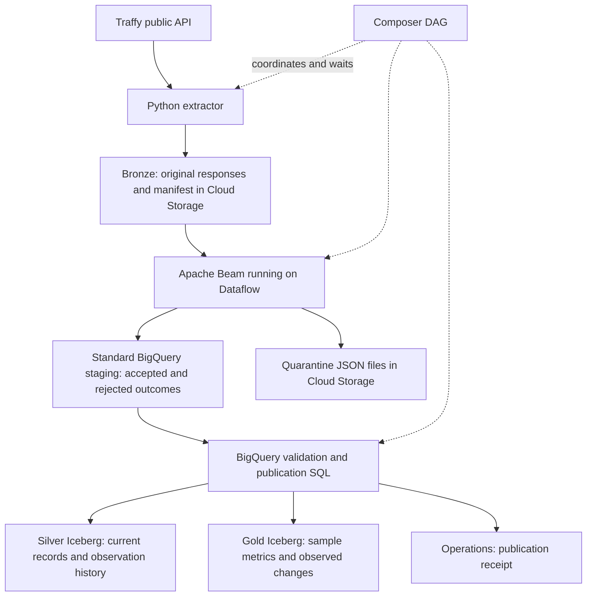

# Traffy Lakehouse: a guided walkthrough

For a tutorial that builds and provisions each component explicitly, start with the
[build-along guide](build-along.md). This page is the optional walkthrough of the finished CLI.

This tutorial explains the code in this repository and gives you an offline exercise before
you use GCP. You will follow one complaint through capture, validation, publication, and reporting.
Cloud examples use `project_name`; you create your own resources using the
[GCP setup guide](gcp-setup.md).

## 1. Understand the question the pipeline answers

A complaint can be reported, worked on, completed, and reopened. Downloading its latest state
once does not show how it changes. We therefore keep both the newest accepted source version
and a history of what each extraction observed.

For this tutorial, imagine these two observations of the same synthetic complaint:

| Observation | Ticket | Source state | Meaning in the example mapping |
| --- | --- | --- | --- |
| First capture | `demo-001` | `กำลังดำเนินการ` | Open / in progress |
| Second capture | `demo-001` | `เสร็จสิ้น` | Closed / completed |

After both captures are successfully published, the current table contains the newer version,
the history table retains both observations, and the change table records the observed transition.
We do not know its exact completion time merely because we observed it as completed later.

The extractor currently takes bounded samples using `limit` and `offset`. It does not guarantee
that every complaint or every change is captured. Consequently, reports describe the sampled
tickets, not all Bangkok complaints.

## 2. Know what each service does



| Component | Its job in this implementation |
| --- | --- |
| Cloud Storage | Stores original captures, quarantine files, temporary data, and the Iceberg warehouse |
| Apache Beam | Defines the Python processing transformations |
| Dataflow | Runs those Beam transformations as a managed batch job |
| BigQuery | Loads staging rows, validates a batch, runs SQL transformations, and serves queries |
| Apache Iceberg | Provides the table format for Silver and Gold data stored in the warehouse bucket |
| Cloud Composer | Runs the Airflow workflow in the required order and manages task retries |

This code uses **BigQuery-managed Iceberg tables**. BigQuery manages their files and metadata
in your bucket; you use SQL to change their contents. The project does not run a separate Spark
cluster or write Iceberg files directly from Beam. See Google's
[managed Iceberg documentation](https://docs.cloud.google.com/bigquery/docs/biglake-iceberg-tables-in-bigquery).

Bronze, Silver, and Gold describe levels of data refinement. Bronze is JSON here; staging and
operations use ordinary BigQuery tables; Silver and Gold use Iceberg.

## 3. Capture the source without losing the original

Read [`capture()` in extract.py](../src/complaint_pipeline/extract.py).

The extractor requests a page, checks the API response envelope, and writes an immutable page
bundle. The bundle contains the original response text, fetch time, request parameters, and a
SHA-256 checksum. A checksum is a fingerprint used to detect changes to saved bytes.

After the requested pages have been captured, the extractor writes `manifest.json`. The
manifest lists exactly which page files belong to the completed capture, along with their
checksums and record counts. Downstream processing reads this list instead of scanning a folder.

```text
run_id=tutorial-001/
  page-0000000000.json
  manifest.json
```

The manifest is the completion marker. If extraction stops before it is written, rerunning
the same run ID resumes the saved pages. It does not overwrite those responses. A completed
run with the same extraction settings returns its existing manifest without fetching again.

**Checkpoint:** explain why a new observation needs a new run ID. Reusing a completed run ID
means replaying the same capture, not asking the API for today's state.

## 4. Validate records and preserve rejected outcomes

Read [`normalize.py`](../src/complaint_pipeline/normalize.py). The local CLI and Dataflow both
call these transformation functions, so they use the same rules.

| Raw value | Normalized value or action |
| --- | --- |
| `count_reopen: "0"` | `reopen_count: 0` as an integer |
| Timezone-aware timestamp | UTC timestamp |
| `type: null` | Empty categories array |
| `coords: ["100.50", "13.75"]` | Numeric longitude and latitude under the configured order |
| Recognized Thai status | Original label plus `open` or `closed` classification |
| Unrecognized Thai status | Original label plus `unknown` classification |
| Invalid timestamp or out-of-range coordinates | Rejected outcome with explicit reasons |

The normalizer also adds the source URI, run ID, observation time, source-row identity,
business-content hash, contract version, and policy hash. These make it possible to trace a
record back to its capture and detect inconsistent processing.

Every record produces a staging outcome, including invalid ones. Dataflow also writes rejected
outcomes to quarantine files. The entire original record remains available in Bronze.

```text
input source rows = accepted source rows + rejected source rows
```

This counts source rows. It is not yet a count of distinct tickets: overlapping API pages may
return the same ticket more than once.

## 5. Run the first observation locally

Run commands from the repository root. If the virtual environment already exists, activate it;
otherwise create it with Python 3.11. Install the local package:

```sh
python3.11 -m venv .venv
source .venv/bin/activate
python -m pip install -e .
```

Create a separate tutorial configuration. This leaves any customized configuration untouched
and uses the package defaults, including the `project_name` placeholder:

```sh
python - <<'PY'
import json
from dataclasses import asdict
from pathlib import Path
from complaint_pipeline.config import Config

root = Path('work/tutorial')
root.mkdir(parents=True, exist_ok=True)
(root / 'config.json').write_text(
    json.dumps(asdict(Config()), ensure_ascii=False, indent=2), encoding='utf-8'
)
PY

complaint-pipeline capture-fixture \
  --input examples/complaints.json \
  --run-id tutorial-001 \
  --bronze-root work/tutorial/bronze

complaint-pipeline normalize \
  --config work/tutorial/config.json \
  --manifest work/tutorial/bronze/run_id=tutorial-001/manifest.json \
  --output work/tutorial/first
```

Expected output:

```json
{"input": 4, "accepted": 3, "quarantined": 1}
```

Open these files:

- `work/tutorial/first/accepted.jsonl`: three valid normalized records.
- `work/tutorial/first/quarantine.jsonl`: one rejected record with validation reasons.
- `work/tutorial/first/summary.json`: the reconciled row counts.
- `work/tutorial/bronze/run_id=tutorial-001/manifest.json`: the completed capture manifest.

Each JSONL line is one JSON object. `demo-001` is open, `demo-002` is closed, and `demo-003`
has an unknown status. The fourth record contains an invalid timestamp, invalid reopen count,
and out-of-range coordinate.

Repeat the capture and normalization commands. The capture is reused and the output stays the
same. This demonstrates local replay; it does not create Silver or Gold tables locally.

## 6. Simulate a later status change

Create a second synthetic API response in `work/`; do not edit the original capture:

```sh
python - <<'PY'
import json
from pathlib import Path

payload = json.loads(Path('examples/complaints.json').read_text(encoding='utf-8'))
for record in payload['results']:
    if record['ticket_id'] == 'demo-001':
        record['state'] = 'เสร็จสิ้น'
        record['last_activity'] = '2026-10-13T05:00:00Z'
Path('work/tutorial/second-response.json').write_text(
    json.dumps(payload, ensure_ascii=False), encoding='utf-8'
)
PY

complaint-pipeline capture-fixture \
  --input work/tutorial/second-response.json \
  --run-id tutorial-002 \
  --bronze-root work/tutorial/bronze \
  --observed-at 2026-10-13T06:00:00+00:00

complaint-pipeline normalize \
  --config work/tutorial/config.json \
  --manifest work/tutorial/bronze/run_id=tutorial-002/manifest.json \
  --output work/tutorial/second

python - <<'PY'
import json
from pathlib import Path

def read_rows(folder):
    lines = Path(f'work/tutorial/{folder}/accepted.jsonl').read_text(encoding='utf-8').splitlines()
    return {row['ticket_id']: row for row in map(json.loads, lines)}

before, after = read_rows('first'), read_rows('second')
for ticket in sorted(before.keys() & after.keys()):
    old, new = before[ticket], after[ticket]
    changed = old['content_hash'] != new['content_hash']
    print(ticket, old['state'], '->', new['state'], 'business fields changed:', changed)
PY
```

Only `demo-001` should report a changed business-content hash. The other two accepted tickets
have new observation provenance but unchanged business values. This difference is why we keep
source-row identity separately from the business-content hash.

Both observations contain one invalid row. The local normalizer reports it without applying
the publication gate. If you tried to publish these batches with the default 5% rejection
threshold, SQL would reject them because 1 of 4 rows is 25%. For a synthetic cloud exercise,
use a separate configuration with an explicitly chosen threshold, or use a clean fixture.

## 7. Understand staging and publication

Read [`beam_pipeline.py`](../src/complaint_pipeline/beam_pipeline.py) and
[`publish.sql`](../src/complaint_pipeline/sql/publish.sql).

In GCP, Dataflow verifies the manifest pages and runs the normalizer. It appends all outcomes
to `staging.complaint_rows` through batch BigQuery load jobs. The staging table is a place to
check the completed batch before changing published data.

Three identifiers have different jobs:

| Identifier | Meaning |
| --- | --- |
| `run_id` | One immutable source capture |
| `processing_id` | A processing attempt over that capture |
| `row_id` | A deterministic source row within its original capture |

Delivery retries can append duplicate staging rows. Publication first rejects conflicting
copies with the same row ID, then collapses identical copies. It checks the unique row count
against the manifest, checks the normalization policy/version, and applies the rejection limit.
It then selects one valid candidate per ticket, preferring the newest source update timestamp.

The SQL performs these operations within one transaction:

1. Append the candidates to `silver.complaint_observation_history`.
2. Merge newer source versions into `silver.complaints_current`.
3. Write the current sample's Gold counts and age bands.
4. Recalculate observed transitions for affected tickets.
5. Write the receipt into `ops.published_runs`.

If a statement fails, the transaction does not commit those published changes. If a run already
has a matching publication receipt, replay is a no-op. A conflicting manifest or policy under
the same published run ID is rejected. All publishers must be serialized; the Composer DAG
limits its own runs to one at a time.

The history table intentionally includes unchanged observations across different captures.
It therefore answers both "what did we observe?" and, through derived comparisons, "what changed?"
An older source version cannot replace a newer current version even if it is processed later.

## 8. Read the resulting reports correctly

After creating resources and publishing a successful GCP batch, replace `project_name` below.
The queries assume the example dataset names.

Check publication quality:

```sql
SELECT run_id, input_rows, accepted_rows, rejected_rows, distinct_tickets,
       input_rows = accepted_rows + rejected_rows AS counts_reconcile
FROM `project_name.ops.published_runs`
ORDER BY published_at DESC;
```

View the newest sample's open complaint counts:

```sql
WITH latest AS (
  SELECT run_id
  FROM `project_name.ops.published_runs`
  ORDER BY observed_at DESC, run_id DESC
  LIMIT 1
)
SELECT organization, tickets
FROM `project_name.gold.daily_backlog`
WHERE run_id = (SELECT run_id FROM latest)
  AND state_group = 'open'
ORDER BY tickets DESC;
```

Inspect observed changes:

```sql
SELECT ticket_id, from_state, to_state, previous_observed_at, observed_at,
       reopen_count_delta
FROM `project_name.gold.observed_state_changes`
ORDER BY observed_at DESC
LIMIT 50;
```

`daily_backlog` includes open, closed, and unknown groups; filter explicitly for the metric
you want. Multiple runs on the same day are separate samples and should not be summed as a
daily unique-ticket count. The age table measures time since reporting for open sampled tickets,
not time to resolution. A missing ticket in a later sample is not evidence of closure.

## 9. Move the working batch to GCP and add Composer

Follow the detailed commands in the [manual deployment guide](gcp-setup.md). Use this order:

| Milestone | Evidence to inspect |
| --- | --- |
| Create buckets, datasets, identities, and connection | Config points to your resources in the intended region |
| Render and run bootstrap SQL | Standard staging/ops and managed Iceberg Silver/Gold tables exist |
| Extract a small sample to GCS | A committed manifest and all its referenced pages exist |
| Submit the Beam job to Dataflow | Job reaches `JOB_STATE_DONE`; inspect staging and quarantine |
| Run publication | A receipt exists and counts reconcile |
| Replay publication | Published row counts stay unchanged |
| Build Flex Template and deploy the DAG | Composer runs all three tasks successfully |

The DAG is [`complaint_medallion.py`](../dags/complaint_medallion.py):

```text
prepare → normalize → publish
```

`prepare` runs extraction in the Composer task and returns configuration, a manifest URI, and
a processing ID through Airflow XCom. It passes metadata, not the complaint payloads.
`normalize` launches the Flex Template and waits for Dataflow completion. `publish` submits
the transactional BigQuery script. Scheduling is initially disabled (`schedule=None`), so
trigger it manually until you have verified the full flow.

A Flex Template consists of a launcher container and a template specification referencing it.
The launcher submits the job and exits; the Airflow operator waits. This follows Google's
[Flex Template guidance](https://docs.cloud.google.com/dataflow/docs/guides/templates/configuring-flex-templates).

## 10. Practice the failure cases

| Exercise | Expected behavior |
| --- | --- |
| Repeat capture with the same run ID | Reuses the completed capture |
| Change extraction limits under the same run ID | Refuses conflicting extraction settings |
| Process malformed records | Produces rejected outcomes and reasons |
| Alter a saved Bronze page | Processing fails its checksum check |
| Publish an incomplete staging batch | Fails manifest count reconciliation |
| Exceed the rejection threshold | Leaves published tables unchanged |
| Repeat a successfully published run | Does not duplicate published records |

Use disposable copies for corruption exercises. Restore original files afterward or create
a fresh capture; a failed checksum should never be bypassed by editing the manifest.
The automated local checks are in [`tests/`](../tests/):

```sh
python -m pip install -e '.[gcp,beam,dev]'
python -m unittest discover -s tests -v
ruff check .
```

The offline exercise verifies extraction and normalization behavior. SQL publication,
permissions, container deployment, and managed orchestration still need smoke tests on your
GCP resources. For exact field rules and sampling limitations, see the
[data contract](data-contract.md).
